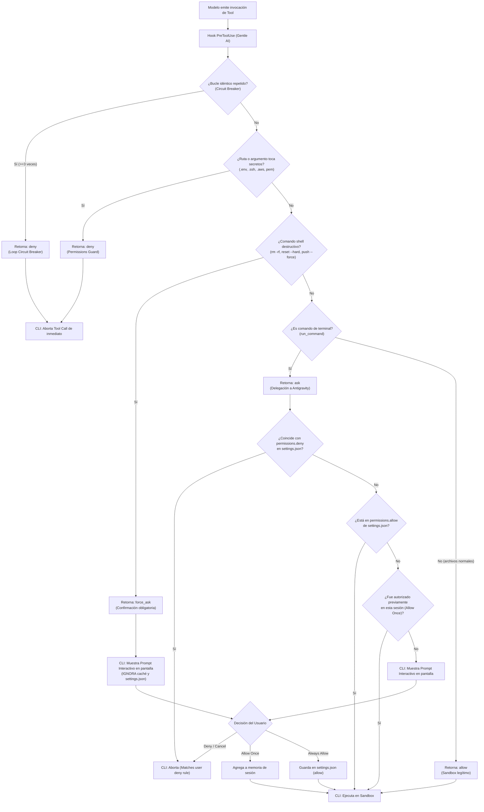

# 3. Orquestación, reglas y hooks

**La integración combina política de prompts con guards ejecutables concretos.** El orchestrator describe cómo coordinar; `PreToolUse` valida un formato y detecta repetición; `Stop` puede recordar un preflight. Ninguna de esas piezas debe confundirse con aprobación de entrega.

[Índice](README.md) · [Transpilación](02-asset-transpiler.md) · [RDD](05-review-transport.md)

## Reglas y carga de contexto

Antigravity gestiona las directivas de comportamiento a través de un sistema de reglas acumulativas (*cumulative*) con prioridades definidas. Para entender cómo encaja Gentle AI, es clave conocer la especificación oficial de reglas de `agy`:

### Jerarquía y descubrimiento de reglas

Antigravity combina las reglas encontradas en distintos niveles en lugar de sobreescribirlas. Ante conflictos, prevalecen las reglas más específicas:
1. **Directorio y subdirectorios:** `<dir>/AGENTS.md`, `<dir>/.agents/rules/*.md` (se evalúan subiendo por el árbol hasta la raíz del workspace).
2. **Workspace:** Reglas en la raíz del proyecto.
3. **Globales de la estación de trabajo:** `~/.gemini/AGENTS.md` y reglas modulares en `~/.gemini/config/rules/*.md`.
4. **Plugins:** Reglas empaquetadas en plugins instalados bajo `~/.gemini/config/plugins/<plugin>/rules/`.

### Estructura de reglas en Gentle AI

Gentle AI distribuye sus directivas en archivos especializados según su ciclo de vida y alcance:

| Archivo instalado | Constructor | Contenido y propósito |
|---|---|---|
| `rules/AGENTS.md` | Inyector de componentes | Persona base del mentor, reglas de estilo y restricciones globales |
| `rules/gentle-ai-routing.md` | `injectAntigravityCLIRule` | Protocolo ODD (Organic Driven Development) y ciclo de trabajo |
| `rules/gentle-ai-orchestrator.md` | Bundle + finalizador de contrato | Orquestador principal y contrato de ejecución RDD renderizado |
| Satélites (`rules/orchestrator-*.md`) | `BundleAssets` | Especificaciones modulares (8 satélites en `rules/` con `trigger: model_decision`) |

Fuentes: [`SystemPromptFile`](../../internal/agents/antigravitycli/adapter.go#L215-L217), [`injectAntigravityCLIRule`](../../internal/components/agentguidance/inject.go#L320-L382), [`ensureAntigravityOrchestratorRule`](../../internal/cli/antigravity_orchestrator_rule.go#L28-L52).

### Frontmatter YAML y modos de activación (`trigger`)

La especificación de `agy` impone una distinción técnica estricta según el tipo de archivo:

1. **`AGENTS.md` no lleva frontmatter:** `agy` trata todo su contenido como Markdown plano y lo mantiene activo permanentemente (`always_on`).
2. **Archivos en `rules/*.md` exigen frontmatter YAML:** Todo archivo modular debe declarar obligatoriamente un `trigger` válido en su cabecera. Si se omite el frontmatter o se usa un valor inválido (por ejemplo, camelCase como `alwaysOn` o `modelDecision`), **`agy` descarta el archivo silenciosamente sin cargarlo**.

Los cuatro modos de activación soportados por `agy` son:
- **`always_on`:** Inyecta el contenido completo en el prompt del sistema en cada turno.
- **`model_decision`:** Inyecta solo el índice de descripciones; el modelo lee el contenido completo bajo demanda.
- **`glob`:** Se activa solo cuando el agente interactúa con archivos que coinciden con los patrones indicados en `globs`.
- **`manual`:** Se carga únicamente mediante mención explícita con `@` en el chat.

Gentle AI configura tanto `gentle-ai-routing.md` como `gentle-ai-orchestrator.md` con `trigger: always_on` porque el flujo de orquestación y el protocolo ODD deben gobernar cada turno de la sesión.

### Presupuesto de tokens y el rol de `description` como red de seguridad

Antigravity aplica dos restricciones técnicas fundamentales para evitar desbordar la ventana de contexto:

- **Límite de 24 KB (`24.000` bytes) por archivo:** Cualquier regla individual que supere los 24.000 bytes (tras expandir inclusiones `@` `[label]` `(path)`) es truncada por `agy`. Por esta razón, el instalador y transpilador de Gentle AI imponen una cota estricta (`antigravityCLIRuleCap = 24000`), validada en [`antigravity_orchestrator_rule_test.go`](../../internal/cli/antigravity_orchestrator_rule_test.go).
- **Presupuesto agregado de 20.000 tokens:** Todas las reglas globales y `always_on` activas comparten una bolsa de 20.000 tokens. Si el total supera este límite, `agy` **degrada automáticamente las reglas más pesadas a punteros livianos** (`- <path>: <description>`) para que el agente las lea solo bajo demanda.
- **Por qué `description` es obligatoria en Gentle AI:** Aunque `description` es estrictamente requerida solo en `model_decision`, Gentle AI la incluye explícitamente en sus reglas `always_on`:
  ```yaml
  ---
  trigger: always_on
  description: Gentle AI orchestrator instructions for Antigravity - coordinator role, delegation ladder, memory and skill registry, review execution contract
  ---
  ```
  Si el usuario carga muchas reglas en su estación y el presupuesto agregado de 20.000 tokens se sobrepasa, `agy` degrada el archivo a su puntero de respaldo. La descripción garantiza que el modelo preserve el contexto de orquestación y sepa cuándo consultar el archivo completo.

## Orquestación: flujo ODD

El orquestador ([`orchestrator.md`](../../internal/assets/antigravitycli/orchestrator.md)) define la disciplina de coordinación de tareas:

```text
Usuario solicita cambio o tarea
  → El orquestador evalúa comprensión y nivel de riesgo
  → Exploración acotada de solo lectura (gentle-ai-explore) si falta contexto
  → Implementación inline (tareas chicas) o delegada a gentle-ai-worker (tareas sustanciales)
  → Validación con tests y verificador independiente (gentle-ai-verify) si hay alto riesgo
  → Síntesis final para el usuario
```

## Inyección del contrato de revisión RDD

Para que el modelo conozca el protocolo de revisión formal de Gentle AI, el paso final del instalador inyecta el contrato canónico dentro de `rules/gentle-ai-orchestrator.md`:

1. Localiza el marcador `<!-- antigravity-review-execution-contract:insert -->` en la plantilla del orquestador.
2. Renderiza el contrato canónico para `agy` vía `reviewassets.ReviewExecutionContractFor(AgentAntigravityCLI)`.
3. Sustituye el marcador atómicamente garantizando idempotencia en ejecuciones sucesivas (`ensureAntigravityOrchestratorRule`).

## Hooks: contrato registrado

El plugin registra cinco eventos. No registra `SessionStart`. La página oficial [Hooks](https://antigravity.google/docs/hooks/) recuperada el 2026-10-06 enumera esos eventos y `hooks.json`, con la misma cautela de tabs/superficies.

| Evento | Timeout en hooks.json | Handler | Efecto |
|---|---:|---|---|
| `PreInvocation` | 30 s | `handleAntigravityPreInvocation` | Primera invocación: refresh/baseline best-effort; salida `{}` |
| `PreToolUse` | 10 s | `handleAntigravityPreToolUse` | Delegación, circuit breaker y guard de rutas sensibles; allow/deny |
| `PostToolUse` | 10 s | `handleAntigravityPostToolUse` | No-op portable: `{}` |
| `PostInvocation` | 30 s | `handleAntigravityPostInvocation` | No-op portable: `{}` |
| `Stop` | 60 s | `handleAntigravityStop` | Solo stop idle/model: bloquea el cierre ante un candidato `review_due` |

Definición: [`antigravityCLIPluginHooksJSON`](../../internal/agents/antigravitycli/adapter.go#L514-L562); dispatch y handlers: [antigravity_hook.go, líneas 88–172](../../internal/cli/antigravity_hook.go#L88-L172), [Stop](../../internal/cli/antigravity_hook.go#L516-L650). Timeouts son configuración solicitada al cliente, no medición de ejecución.

El comando registrado llama directamente `gentle-ai hook run --agent=antigravity-cli --event <evento>`. También se escriben `hook.sh` y `hook.cmd`; no afirmar que hooks.json siempre los invoca: [`DeployPluginTreeToDir`, líneas 574–755](../../internal/agents/antigravitycli/adapter.go#L574-L755).

## `PreToolUse`: condiciones fail-closed

### Validación del payload

- JSON vacío, null, array o malformed en `PreToolUse` → `deny`.
- `invoke_subagent` debe tener `Args.Subagents` array no vacío.
- Cada entrada requiere strings no vacíos `TypeName`, `Role`, `Prompt`.
- `Workspace`, si aparece, debe ser `inherit`, `branch` o `share`.
- Una herramienta distinta no recibe esa validación especial.
- Las tools de archivo y búsqueda (`view_file`, `read_file`, `write_file`, `edit_file`, `replace_file_content`, `multi_replace_file_content`, `grep_search`) reciben el guard de rutas sensibles: los patrones que el `settings.json` no puede expresar (el esquema del proveedor no tiene globs de archivo) se evalúan sobre la ruta concreta a cualquier profundidad y devuelven `deny`.
- Los comandos de terminal (`run_command`) que referencian rutas sensibles (secretos como `.env*`, `.ssh`, `.aws`, claves `.pem`/`.key`) son bloqueados directamente con `deny`, impidiendo filtraciones o bypasses vía shell (ej. `cat .env`).
- Los comandos de terminal destructivos (`rm -rf`, `git reset --hard`, `git push --force`, `git clean -fd`, `chmod -R 777`, etc.) devuelven `force_ask`: obligan al CLI a solicitar confirmación interactiva al usuario en pantalla, **ignorando cualquier regla previa en `settings.json` o caché de sesión**.
- Los comandos de terminal estándar devuelven `ask`: delegan la decisión en el motor de permisos de Antigravity CLI, respetando la lista `permissions.allow` del usuario si ya fue autorizada, o solicitando confirmación si se trata de un comando nuevo.
- Las operaciones estándar de archivo dentro del workspace devuelven `allow` (comportamiento habitual del sandbox).

[`RunAntigravityCLIHook`](../../internal/cli/antigravity_hook.go#L88-L108), [`validateAntigravityCLIInvokeSubagentArgs`](../../internal/cli/antigravity_hook.go#L759-L807), [`antigravityCLIValidWorkspace`](../../internal/cli/antigravity_hook.go#L823-L830).

Ejemplo de **forma esperada por el handler**, no prueba oficial de schema nativo completo:

```json
{
  "toolCall": {
    "name": "invoke_subagent",
    "args": {
      "Subagents": [{
        "TypeName": "gentle-ai-explore",
        "Role": "explorer",
        "Prompt": "Mapear solo los archivos autorizados y devolver referencias.",
        "Workspace": "inherit"
      }]
    }
  }
}
```

El handler no demuestra que `TypeName` exista, no analiza si el prompt respeta todas las superficies ni autoriza un rol RDD por recibir ese string. Tests: [`PreToolUseEdgeCases`](../../internal/cli/antigravity_hook_test.go#L473-L505), [`TestAntigravityHookPreToolUseMalformedInvokePayloadFailsClosed`](../../internal/cli/antigravity_hook_test.go#L622-L664), [`TestAntigravityHookPreToolUseInvokeSubagentValidation`](../../internal/cli/antigravity_hook_test.go#L666-L771).

### Circuit breaker

Con `conversationId` y herramienta válida:

```text
(nombre + hash JSON canónico de args) idénticos
  llamada 1 → allow, count 1
  llamada 2 → allow, count 2
  llamada 3 → deny, count 3
  cambio de nombre/args → reinicia count 1
```

[`handleAntigravityPreToolUse`](../../internal/cli/antigravity_hook.go#L921-L1017). Se persiste bajo `.gentle-ai/circuit-breaker/v1/<sha256(conversationId)>.json`, con fallback temporal si HOME no está disponible. El orden de claves de JSON no evade identidad: [`PreToolUseKeyOrdering`](../../internal/cli/antigravity_hook_test.go#L301-L339).

Sin conversationId, toolCall o nombre, el circuit breaker retorna allow — el guard de rutas sensibles se evalúa antes y no depende de conversationId: [líneas 944–949](../../internal/cli/antigravity_hook.go#L944-L949). No es un detector de todos los loops ni de equivalencia semántica de comandos; solo repetición consecutiva de nombre/args. Persistencia fallida puede debilitar seguimiento entre invocaciones; no se trata de garantía universal anti-loop.

## `PreInvocation`: inicialización de sesión

Cuando inicia una nueva interacción (`InvocationNum == 0`), el hook ejecuta tareas de sincronización inicial en segundo plano:
- Refresca el índice de skills.
- Asegura la exclusión de metadatos de sincronización (`.atl`). Si el repositorio ya tiene `.gitignore`, la regla se suma ahí; si no lo tiene, la regla va al archivo local de exclusión de git (`.git/info/exclude`), **no** se crea un `.gitignore` en el repo del usuario: un archivo sin trackear vuelve inasableable todo candidato de revisión y el recordatorio quedaría bloqueando siempre.
- Registra el punto base (baseline) del repositorio si RDD está activo.

## `Stop`: cierre bloqueado ante un candidato de alto riesgo

Si el modelo finaliza su turno (`NO_TOOL_CALL` en Antigravity CLI, o `model_stop` para compatibilidad) y el sistema queda desocupado (`fullyIdle == true`), el hook comprueba si existe un candidato sin revisar **y** si ese candidato es `review_due`:
- Resuelve el target y exige `Action=start` (cambios trackeados sin revisar). No exige un `NextTransition` ejecutable: archivos no trackeados pueden dejar el estado en `collect` aunque exista un candidato válido.
- Consulta la misma evaluación in-process que publica `review assess` (`reviewStopHookReviewDue`). Un candidato pasivo o medio (`review_due == false`) cierra con `{}`. Una evaluación que no puede responder **falla cerrada a due**, así el recordatorio no se pierde por un error de assess; un candidato inassessable (por ejemplo, archivos no trackeados sin declarar) también queda `review_due`, porque el hook no elige `--untracked-scope` por el operador.
- De-silencia en dos casos acotados: el candidato es el baseline registrado en la primera invocación (anterior a la sesión) o el operador rechazó el consentimiento hace menos de 15 minutos.
- Si corresponde, emite `decision: "continue"`. Según el contrato oficial de hooks, `continue` **impide que el agente termine y lo reinserta en el loop de ejecución**, con el `reason` inyectado como mensaje de sistema — es un bloqueo del cierre, no un recordatorio decorativo. El `reason` nombra lo que el candidato **es**, según el `reason_code` de la transición que el hook ya resolvió:
  | `reason_code` | Candidato | Qué dice el `reason` |
  |---|---|---|
  | `fresh_target_ready` | cambios pendientes | "unreviewed candidate changes detected since session baseline" |
  | `empty_candidate_base_ref_required` | rango commiteado (el worktree no tiene cambios pendientes) | "unreviewed committed work detected … the review needs a base ref to compare against" |
  | `intended_untracked_selection_required` | cambios pendientes + archivos sin trackear sin declarar | "unreviewed candidate changes detected … the review needs the untracked selection to be declared" |
  ```json
  {
    "decision": "continue",
    "reason": "Receipt-Driven Development: unreviewed candidate changes detected since session baseline (target sha256:…). Run the STATUS preflight: … Then run the provider-issued START unchanged: …. This Stop reminds once per content generation: it stays quiet while the candidate's content does not change."
  }
  ```
  La cola del `reason` sigue la política: si el recibo puede liquidar la generación, dice que el Stop calla mientras el contenido no cambie; si el ledger no puede atribuir el candidato, dice que el Stop sigue bloqueando hasta que la revisión se consuma.
- El recordatorio se consume como un recibo, igual que en Gentle Shell: `PostToolUse` registra cada escritura completada en el ledger de la sesión (`~/.gentle-ai/antigravity-mutations/v1/`), y el recordatorio liquida el prefijo que cubrió. Una escritura posterior gana su propio recordatorio.
- El recibo liquida además el **contenido** del candidato (`projection.current_candidate_tree`, la huella del árbol del workspace): es estable al commitear y cambia en cuanto cambia el contenido de cualquier archivo. Hace falta porque un subagente corre en su propia conversación y sus escrituras nunca entran al ledger del padre — sin esa huella, un recordatorio podría liquidarse sobre trabajo que nadie revisó.
- Cuando el ledger **no puede atribuir** el candidato (la sesión no registró escrituras bajo ese repositorio, o usó una herramienta que el ledger no observa), el recordatorio **no** se consume: el mismo candidato sigue bloqueando hasta que el estado avance (consumed-check), para que ignorar el primer aviso no alcance para cerrar. `agy` corta el bloqueo tras un número configurable de continuaciones consecutivas.
- Sin candidato, sin RDD activo o sin repositorio, emite `{}` y la sesión cierra con normalidad.

## Política de seguridad y respuestas de los hooks

Los hooks de Gentle AI operan con un enfoque de seguridad estricto (*fail-closed* ante cargas corruptas o bucles, y *no-op* transparente para eventos posteriores):

| Escenario | Respuesta del hook | Comportamiento |
|---|---|---|
| Carga malformada o inválida en `PreToolUse` | `deny` | Bloquea la llamada a la herramienta para evitar fallos inesperados |
| Delegación a subagente sin campos requeridos | `deny` | Exige `TypeName`, `Role` y `Prompt` obligatorios |
| Ruta sensible en tools de archivo/búsqueda | `deny` | Guard sobre la ruta concreta: `.env` y variantes, `.ssh`, `.credentials`, `.aws/credentials`, `.pem`/`.key`, `hosts.yml`, Keychains, `secrets/` a cualquier profundidad |
| Comando de terminal con ruta sensible | `deny` | La línea de `run_command` se tokeniza y si referencia secretos se bloquea directamente para evitar bypasses de lectura |
| Comando de terminal destructivo | `force_ask` | Detecta `rm -rf`, `git reset --hard`, `push --force`, etc.; exige confirmación interactiva obligatoria ignorando cachés o reglas de `allow` |
| Comando de terminal estándar | `ask` | Delega la decisión en Antigravity CLI: ejecuta si está en `permissions.allow` del usuario, o pide confirmación si no lo está |
| 3 llamadas consecutivas idénticas (Circuit Breaker) | `deny` | Interrumpe bucles infinitos repetitivos del modelo |
| Operaciones estándar de archivo | `allow` | Permite la ejecución de la herramienta de archivo dentro del sandbox |
| Eventos posteriores (`PostToolUse`, `PostInvocation`) | `{}` | No bloqueantes, no interfieren con la respuesta del agente |
| Cierre con un candidato `review_due` | `continue` | Bloquea el cierre: el loop continúa con el reason inyectado como mensaje de sistema. El recordatorio no de-silencia por sí mismo: el mismo candidato sigue bloqueando hasta que el estado avance (consumed-check) |
| Cierre con un candidato pasivo o medio | `{}` | No es `review_due`: la sesión cierra sin recordatorio |
| Cierre estándar sin pendientes | `{}` | Permite el cierre normal de la interacción |

### Jerarquía de permisos y resolución de conflictos (Hook vs settings.json)

La evaluación de seguridad en Antigravity CLI opera mediante una separación estricta de responsabilidades entre el Hook de ciclo de vida (`PreToolUse`) y el motor nativo de permisos del CLI (`settings.json` y memoria de sesión). Gentle AI **no inyecta overlays estáticos en `settings.json`**; las entradas en `settings.json` provienen exclusivamente de las reglas configuradas por el usuario o autorizadas interactivamente con *Always Allow*:

| Si el Hook de Gentle AI dice | Si en `settings.json` está como `ask` | Resultado Final (CLI) | Explicación técnica |
|---|---|---|---|
| **`deny`** *(Secretos / Breaker)* | `ask` o no configurado | **`deny` (Bloqueo total)** | Precedencia de corte absoluto. Se aborta sin consultar al usuario. |
| **`force_ask`** *(Comandos destructivos)* | `allow` o `ask` | **`force_ask` (Confirmación obligatoria)** | Anula cualquier caché o `allow` previo. El usuario debe confirmar en pantalla. |
| **`ask`** *(Comando estándar)* | `"command(cmd)"` en `allow` | **`allow` (Ejecución directa)** | Antigravity consulta `settings.json` y ejecuta sin interrumpir al usuario. |
| **`ask`** *(Comando estándar)* | No en `allow` (postura `ask`) | **`ask` (Prompt interactivo)** | Antigravity solicita autorización interactiva (*Allow Once / Always Allow / Deny*). |
| **`allow`** *(Archivos estándar sandbox)* | `ask` o no configurado | **`allow` (Ejecución directa)** | El `"allow"` del hook actúa como autorización del plugin para herramientas legítimas de archivo. |

### Diagrama de Flujo de Evaluación de Permisos



**Campos opcionales del envelope de respuesta:** el tipo `AntigravityCLIHookOutput` declara además `injectSteps` (array) y `terminationBehavior` (string), con sus nombres JSON fijados por un test de serialización: [`antigravity_hook_test.go`](../../internal/cli/antigravity_hook_test.go#L546-L563). **Ningún handler los emite hoy**: la integración responde únicamente `{}`, `decision` o `reason`. Que el tipo los declare y que el test fije su serialización no prueba que `agy` los interprete ni que exista un comportamiento de terminación asociado.

---

**Siguiente paso:** [MCP y la prueba del benchmark](04-codegraph-and-benchmarks.md).
