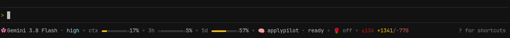
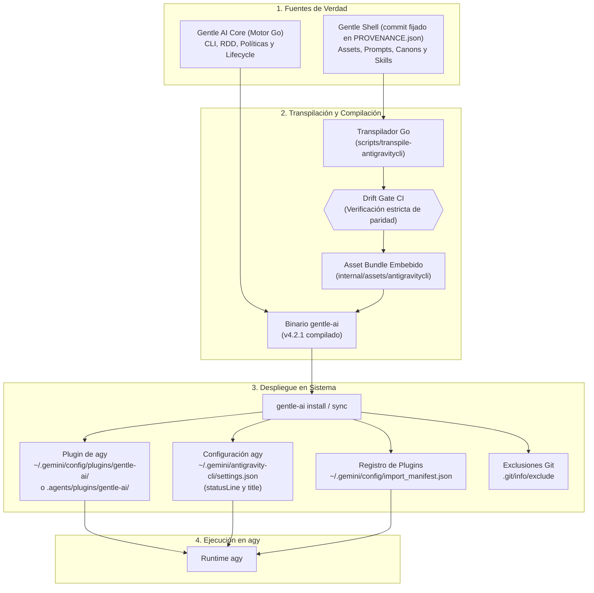
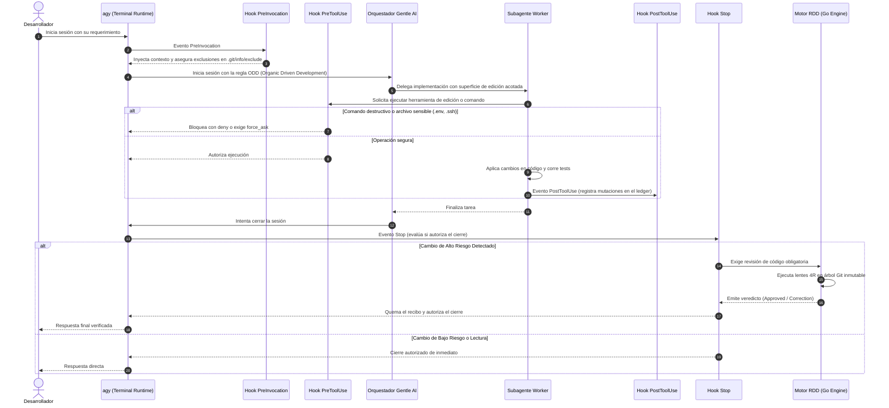

# Google Antigravity CLI (`agy`) con Gentle AI

Integración nativa de primer nivel de **Google Antigravity CLI (`agy`)** en **Gentle AI**. Diseñada específicamente para aprovechar al máximo las capacidades de `agy` como runtime autónomo: arquitectura modular de plugins, 10 subagentes nativos especializados, ciclo de vida con hooks, statusline y título dinámicos, evaluación en memoria de permisos y revisión adversarial automatizada basada en recibos inmutables (RDD con lentes 4R).

> [!IMPORTANT]
> **Versión fijada actual**: **v4.2.1** (basada en upstream Gentle AI v4.2.0, Gentle Shell v4.3.0 y Antigravity CLI v1.4.4).

---

## 1. Inicio Rápido (Quick Start)

### Paso 1: Prerrequisitos
Asegurate de haber abierto `agy` e iniciado sesión al menos una vez y tener Go 1.25+ en tu sistema:
```bash
agy --version
go version
```

### Paso 2: Instalación del binario `gentle-ai` (Desde este Fork)

```bash
git clone -b agy/ai-v4.2.0_shell-v4.3.0 https://github.com/ariasbruno/gentle-ai.git
cd gentle-ai
go install ./cmd/gentle-ai
```

### Paso 3: Instalación en Antigravity CLI

Elegí el alcance según tu flujo de trabajo (consultá la [Guía de Instalación Detallada](installation.md)):

- **Instalación Global (en toda tu máquina):**
  ```bash
  gentle-ai install --agent antigravity-cli --scope global
  ```

- **Instalación en Workspace (aislada solo a este repositorio):**
  ```bash
  gentle-ai install --agent antigravity-cli --scope workspace
  ```

*(Opcional: Si querés que además configure la StatusLine y el título dinámico en `settings.json`, sumá el flag `--include-theme` a los comandos anteriores).*

*(Nota: el comando `gentle-ai sync` no hace falta al instalar; solo se utiliza después, en el día a día, si actualizás el binario y querés refrescar el plugin).*

#### ¿Venías usando la integración genérica de Antigravity? (Migración obligatoria)
En upstream existe un adaptador genérico llamado `antigravity` que intentaba abarcar todo el ecosistema (IDE, 2.0 y CLI) escribiendo configuración tanto en `.gemini/antigravity-cli/` como en `GEMINI.md`.

> [!WARNING]
> **No es posible usar ambas integraciones al mismo tiempo:** Ambos adaptadores configuran el entorno de Antigravity en tu máquina. Mantener los dos activos provocaría duplicación de skills, configuraciones redundantes y colisiones en la terminal. **Debés elegir uno u otro.**

- **Para migrar al adaptador de Antigravity CLI:**
  Desinstalá primero el adaptador genérico e instalá el adaptador dedicado:
  ```bash
  gentle-ai uninstall --agent antigravity
  gentle-ai install --agent antigravity-cli --scope global
  ```

> [!NOTE]
> **Compatibilidad con Antigravity IDE y Antigravity App (2.0):** Esta integración está centrada, optimizada y verificada en **Antigravity CLI (`agy`)**. Sin embargo, debido a que Antigravity IDE y Antigravity App (2.0) comparten gran parte de la infraestructura base de Antigravity, esta integración es **posiblemente compatible con Antigravity IDE y Antigravity App (2.0)**, aunque esto **no ha sido probado oficialmente aún**.

### Paso 4: Verificación de la instalación

1. **Validar el plugin de Antigravity CLI (Mandatorio):**
   Comprobá que el plugin cumpla al 100% las especificaciones oficiales de `agy`:
   ```bash
   agy plugin validate --strict ~/.gemini/config/plugins/gentle-ai
   ```
   *(Verifica manifiestos, esquemas, los 10 subagentes, skills y hooks con 0 errores y 0 warnings).*

2. **Diagnóstico general de Gentle AI (Opcional):**
   ```bash
   gentle-ai doctor
   ```
   *(Comprueba herramientas del sistema, espacio en disco y conectividad con la memoria persistente Engram).*

---

## 2. El Ecosistema Antigravity y la Necesidad de un Adaptador Dedicado

> [!NOTE]
> **Convención de términos a partir de ahora:**
> Una vez superado el Quickstart para el usuario final, nos adentramos en los detalles técnicos de la integración. Para mantener un lenguaje claro, ágil y sin repeticiones:
> - **`agy`**: Hace referencia específica a **Antigravity CLI** (el runtime de terminal sobre el cual trabaja este fork).
> - **`antigravity`**: Hace referencia a todo el ecosistema completo de Google (**Antigravity IDE**, **Antigravity App (2.0)** y **Antigravity CLI**), que es con lo que Gentle AI interactúa originalmente a través de su adaptador genérico.
>
> En síntesis: **Este FORK trabaja sobre `agy`**, mientras que **Gentle AI trabaja originalmente con `antigravity`**.

El ecosistema de Google Antigravity engloba tres superficies de trabajo bien diferenciadas:

1. **Antigravity IDE**: El editor de código tradicional de Antigravity, con su autocompletado, comandos de código en lenguaje natural y asistencia en edición con un IA.
2. **Antigravity App (2.0)**: La plataforma dedicada de Google Antigravity para trabajar con agentes (anteriormente conocida como Antigravity 2.0).
3. **Antigravity CLI (`agy`)**: La superficie de terminal de Google Antigravity para interactuar con agentes directamente en la consola.

### La problemática del enfoque genérico de upstream
En Gentle AI upstream existe un único adaptador genérico llamado `antigravity` que intentó abarcar estas tres superficies en una sola bolsa:
- Trata a la terminal como si fuera un editor pasivo: concatena directivas en un único archivo plano (`.gemini/GEMINI.md`), sin aprovechar el sistema de plugins estructurado de `agy`.
- **No provee subagentes** (`SubAgentsDir` queda vacío), privando a la terminal de agentes especializados en exploración o verificación.
- **Carece de transporte RDD**, impidiendo que los usuarios de Antigravity ejecuten revisiones formales bajo Receipt-Driven Development.
- Mezcla rutas entre `antigravity-desktop` y `antigravity-cli`, intentando escribir configuraciones en ambos sitios.

### Nuestra solución: Adaptador especializado para CLI
En lugar de forzar a la terminal a conformarse con un prompt plano, creamos el adaptador dedicado **`antigravity-cli`** (`model.AgentAntigravityCLI`). Este adaptador explota **el 100% de las posibilidades que `agy` ofrece como runtime moderno de agentes** (plugins nativos, 10 subagentes en Markdown, 5 hooks de ciclo de vida, statusline en Go y transporte RDD sandboxed).

*(Este fork se enfoca en la integración de Gentle AI en `agy`, pero como se indicó, es posiblemente compatible también con el resto del ecosistema `antigravity` (IDE y App/2.0), aunque no está certificado).*

### Cuadro Comparativo de Enfoques

| Capacidad / Dimensión | Upstream Genérico (`antigravity` para IDE/App/CLI) | Esta Integración (`antigravity-cli` especializada) | Justificación Técnica |
|---|---|---|---|
| **Público y Entorno** | Enfoque genérico para IDE, App (2.0) y CLI | Especializado en CLI (`agy`), posiblemente compatible con IDE y App (2.0) | La terminal de agentes autónomos requiere herramientas y hooks que un editor no usa. |
| **Mecanismo de Carga** | Archivo plano `.gemini/GEMINI.md` | Plugin nativo (`plugin.json`, `rules/`, `agents/`, `skills/`) | `agy` cuenta con un sistema formal de plugins y reglas jerárquicas. |
| **Subagentes** | ❌ Ninguno (`SubAgentsDir: ""` vacío) | ✅ 10 subagentes nativos en Markdown | `agy` soporta delegación autónoma (`invoke_subagent`). |
| **Ciclo de Vida y Hooks** | ❌ No implementado | ✅ 5 hooks declarativos (`PreInvocation`, `PreToolUse`, etc.) | Permite control de seguridad, métricas de sesión y ledger inmutable. |
| **Revisión de Código RDD** | ❌ No disponible (`transport: nil`) | ✅ Transporte in-process sandboxed (Lentes 4R) | Ejecución determinista de revisiones y refutaciones en terminal. |
| **Barra de Estado** | ❌ No disponible | ✅ Statusline in-process y título dinámico en Go | Terminal enriquecida con gauges de cuota, Engram y avance ODD. |
| **Políticas de Seguridad** | ❌ Ninguna | ✅ Filtros en memoria (`PreToolUse`, `force_ask`) | Bloqueo preventivo de secretos y advertencia en comandos destructivos. |
| **Aislamiento de Scope** | ⚠️ Mezcla rutas en `.gemini/` | ✅ `--scope global` vs `--scope workspace` (`.agents/plugins`) | Aislamiento por repositorio para equipos con requerimientos específicos. |

*(Para una comparativa técnica en profundidad, consultá [ide-vs-cli.md](ide-vs-cli.md) y la [propuesta para upstream](propuesta-upstream.md)).*

---

## 3. Mapa Completo de Componentes y Superficies Desplegadas

El siguiente mapa describe todos los componentes instalados, registros de integración y almacenamiento en runtime:

```text
Entorno del Sistema y Repositorio
│
├── 1. Plugin Gentle AI
│   (Global: ~/.gemini/config/plugins/gentle-ai/  |  Workspace: <repo>/.agents/plugins/gentle-ai/)
│   ├── plugin.json                                      # Manifiesto del plugin para agy
│   ├── mcp_config.json                                  # Servidores MCP (CodeGraph, Context7, Engram)
│   ├── hooks.json                                       # Definición de hooks de ciclo de vida
│   ├── hooks/                                           # Ejecutables puente (hook.sh / hook.cmd)
│   ├── rules/                                           # Reglas operativas (AGENTS.md, orchestrator, routing ODD, strict-tdd)
│   ├── agents/                                          # 10 Subagentes nativos Markdown
│   ├── skills/                                          # Catálogo completo de skills transpiladas
│   ├── chains/                                          # Flujos compuestos (4r-review.chain.md)
│   └── .native-rule-ownership.json                      # Registro de propiedad y digests de reglas
│
├── 2. Integración de StatusLine y Título (~/.gemini/antigravity-cli/settings.json)
│   ├── "statusLine": {"type": "command", "command": "gentle-ai statusline"}
│   └── "title": {"type": "command", "command": "gentle-ai statusline --title"}
│       (Configuración de usuario; gentle-ai preserva settings.json sin mutaciones automáticas en sync).
│
├── 3. Registro Global de Plugins (~/.gemini/config/import_manifest.json)
│   └── Registra el plugin de Gentle AI para su descubrimiento y carga inmediata en el arranque de agy.
│       (Solo en instalación global; en workspace se omite para aislamiento total).
│
├── 4. Aislamiento Limpio del Repositorio Local (<repo>/.git/info/exclude)
│   └── Excluye automáticamente artefactos internos (.atl, carpetas scratch) sin modificar el .gitignore del proyecto.
│
└── 5. Configuración y Estado en Tiempo de Ejecución (~/.gentle-ai/)
    ├── statusline.json                                  # Configuración de usuario para statusline (densidad y visibilidad)
    ├── statusline-phase/<conv_hash>.json                # Detección de fase de trabajo inferida vía PreToolUse
    ├── statusline-engram-state.json                     # Estado dinámico de observaciones Engram capturadas
    ├── statusline-rdd-cache.json                        # Caché del estado de revisión RDD
    ├── statusline-changes-cache.json                    # Caché de diferencias Git
    └── antigravity-mutations/v1/<conv_hash>.jsonl       # Ledger inmutable de mutaciones de archivos por sesión
```

### Barra de Estado y Título Dinámicos (`gentle-ai statusline`)

Gentle AI provee una statusline rica y nativa ejecutada in-process sin dependencias externas (`jq` o `bash`), totalmente compatible con Linux, macOS y Windows:



- **Pétalo estático**: Muestra el glifo de rosa estático `✿` en rosa Gentleman (`ansiRose + ansiBold + "✿"`), consistente y sin animación en todos los estados del agente.
- **Modo y modelo**: Refleja el modo de ciclo activo (ej. `auto · Gemini 3.8 Flash`).
- **Gauges de contexto y cuotas**: Muestra el consumo de la ventana de contexto (`ctx ▰▰▰▱▱▱▱▱ 43%`) y el tiempo restante de cuota.
- **Memoria Engram reactiva**: Indica el estado del proyecto (`🧠 <proyecto> · ready` o `✓ saved #id` al registrar observaciones).
- **Autoridad RDD**: Estado en vivo de revisiones de código (`🌹 Review in progress`, `✓ Approved`, `Fixing findings…`).
- **Métricas Git y Tareas ODD**: Contador de cambios (`±N +A/−D`) y avance de tareas del documento ODD más reciente (`⋗ 12/17 · T15 in_progress`).
- **Atajos alineados a la derecha**: Muestra `? for shortcuts` (o `?` en terminales compactas) alineado al margen derecho.
- **Auto-silenciado inteligente**: Si el plugin se desactiva en `config.json`, la barra se apaga automáticamente para no ensuciar la salida.
- **Personalización del usuario**: Mediante `~/.gentle-ai/statusline.json` podés ajustar la densidad (`comfortable`, `compact`, `minimal`) y alternar la visibilidad de cualquier segmento. Para más detalles, consultá la [Guía completa de StatusLine](statusline.md).

---

## 4. Arquitectura y Flujo de Trabajo

### Diagrama 1: Cadena de Transpilación y Despliegue
Gentle Shell es la fuente de verdad canónica. El transpilador adapta y valida los assets, los embebe en el binario Go y el comando `install/sync` despliega el plugin y el registro:



---

### Diagrama 2: Ciclo de Vida de una Sesión con Hooks y RDD
Durante una sesión interactiva, los hooks de `agy` colaboran con el motor en Go para auditar mutaciones, proteger archivos sensibles y exigir revisiones antes de cerrar cambios de alto riesgo:



---

## 5. Matriz de Subagentes Nativos Incluidos

Gentle AI dota a `agy` de 10 subagentes nativos configurados en formato Markdown:

| Categoría | Subagente | Rol y Responsabilidad | Herramientas |
|---|---|---|---|
| **Ciclo ODD** | `gentle-ai-explore` | Exploración de arquitectura, codebase e investigación previa | Solo lectura |
| | `gentle-ai-worker` | Implementación con superficie de edición estrictamente acotada | Edición + Tests |
| | `gentle-ai-verify` | Verificación técnica de cumplimiento de requisitos y pruebas | Solo lectura |
| **Judgment Day** | `jd-judge-a` | Primer juez ciego adversarial e independiente | Solo lectura |
| | `jd-judge-b` | Segundo juez ciego adversarial e independiente | Solo lectura |
| | `jd-fix-agent` | Agente quirúrgico de resolución para hallazgos confirmados | Edición + Tests |
| **Revisión 4R (RDD)** | `review-risk` | Lente R1: Seguridad, privilegios, fuga de datos y credenciales | Solo lectura |
| | `review-readability`| Lente R2: Nombres, complejidad, claridad de contratos y mantenibilidad | Solo lectura |
| | `review-reliability`| Lente R3: Pruebas behavior-first, cobertura, determinismo y regresiones | Solo lectura |
| | `review-resilience` | Lente R4: Recuperación de fallos, retries, backoff y carga | Solo lectura |

---

## 6. Documentación Modularizada

La documentación se organiza según la audiencia y el objetivo técnico:

### 📘 Guías Operativas para el Usuario
- [**Guía de Instalación Paso a Paso (installation.md)**](installation.md): Opciones global y workspace, flag opcional `--include-theme` y qué se copia en disco.
- [**StatusLine y Experiencia de Terminal (statusline.md)**](statusline.md): Explicación de cada segmento, atajos de teclado, cuotas de modelos y auto-silenciado.
- [**Seguridad, Jerarquías y Sandbox (security-and-sandbox.md)**](security-and-sandbox.md): Confinamiento del sandbox, capas de jerarquía, prevención de lectura de secretos (`.env`) e higiene con `.git/info/exclude`.
- [**Resolución de Problemas (troubleshooting.md)**](troubleshooting.md): Diagnóstico rápido con `gentle-ai doctor` y respuestas a preguntas frecuentes.
- [**El Ecosistema Antigravity: IDE, App (2.0) y CLI (ide-vs-cli.md)**](ide-vs-cli.md): Explicación del ecosistema, diferencias entre el adaptador genérico y el dedicado, y por qué no usarlos a la vez.

### 🏛️ Para Mantenedores de Upstream y Auditoría Técnica
- [**Propuesta de Integración Upstream (propuesta-upstream.md)**](propuesta-upstream.md): Documento técnico para el equipo de Gentle AI justificando el desacople de CLI e IDE, arquitectura de assets, drift gate determinista y ausencia de regresiones.
- [**Fundamentos y Puesta en Marcha (01-foundation.md)**](01-foundation.md): Despliegue de assets y directivas del plugin.
- [**Transpilador Determinista (02-asset-transpiler.md)**](02-asset-transpiler.md): Transpilación desde Gentle Shell y drift gate `--check`.
- [**Orquestación y Hooks (03-orchestration-and-hooks.md)**](03-orchestration-and-hooks.md): Hooks de ciclo de vida y ledger de mutaciones.
- [**Transporte RDD In-Process (05-review-transport.md)**](05-review-transport.md): Arquitectura de revisión sandboxed y esquemas 4R.
- [**Comparativa frente a otros Agentes (07-comparison.md)**](07-comparison.md): Tabla comparativa con Claude, Codex, OpenCode y Pi.
- [**Registro de Decisiones (08-decisions.md)**](08-decisions.md): Decisiones arquitectónicas, tradeoffs y alternativas descartadas.
- [**Registro de Verificación (09-verification.md)**](09-verification.md): Evidencia de suites de prueba, benchmarks y validación estricta.
- [**Mapa Técnico Completo (SUMMARY.md)**](SUMMARY.md): Diagramas Mermaid de secuencias y flujo transaccional.

### 🌐 Propuesta de Integración Upstream (Para Maintainers de Gentle AI)
Toda la justificación técnica, matriz de no-regresión y especificaciones detalladas para mergear esta integración al repositorio oficial se encuentran en:
- [**Propuesta de Integración Upstream (propuesta-upstream.md)**](propuesta-upstream.md)
