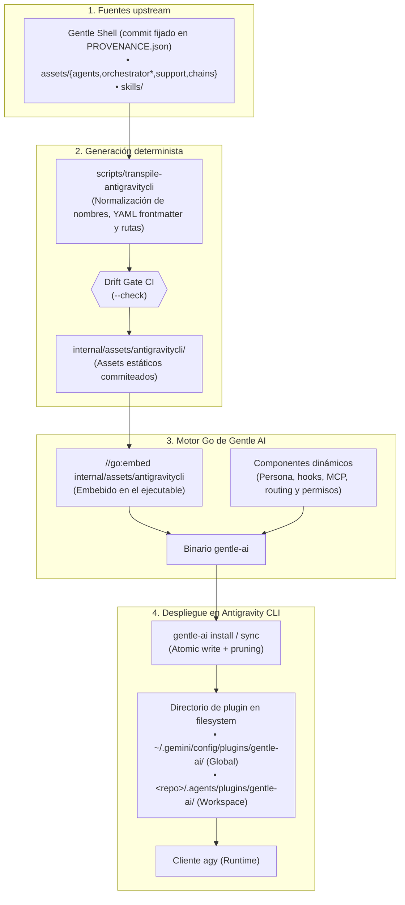
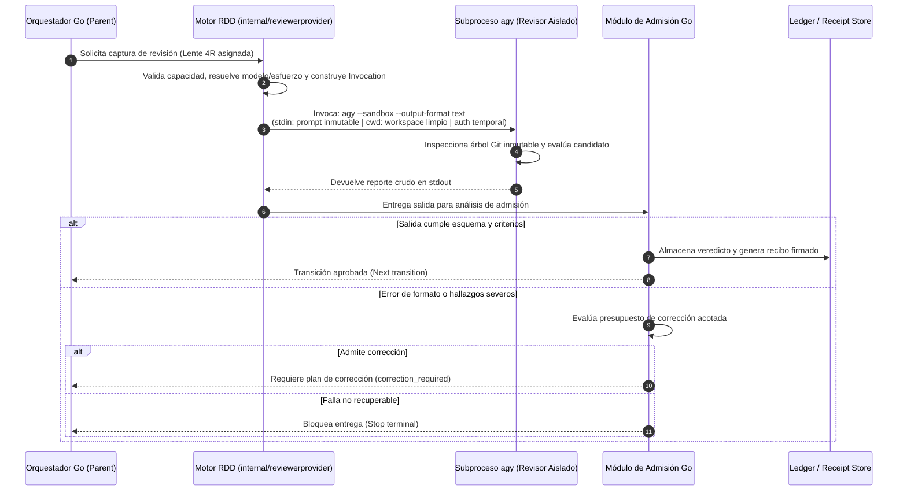

# Mapa Técnico y Mecánica Interna de la Integración

**Existen dos procesos con responsabilidades separadas en esta integración:**
1. **Configuración y despliegue del plugin** que acompaña las sesiones de desarrollo en `agy`.
2. **Captura y evaluación de revisiones RDD** mediante un subproceso dirigido por el motor en Go.

Aunque comparten el identificador de runtime (`antigravity-cli`), no deben confundirse sus mecanismos de carga, modelos, sandboxing ni autoridad.

[Volver a la Guía Principal (README.md)](README.md) · [Comparación con otros Runtimes](07-comparison.md) · [Registro de Decisiones](08-decisions.md) · [Registro de Verificación](09-verification.md)

---

## 1. Cadena de Custodia y Transpilación de Assets

Gentle Shell es la fuente original de los canons y habilidades. El binario de Gentle AI no copia archivos al azar en tiempo de ejecución: transpila, fija y audita cada byte en tiempo de compilación.

Fuentes de auditoría:
- Transpilación principal: [`transpileAll`](../../scripts/transpile-antigravitycli/main.go#L243-L291)
- Normalización de skills: [`transpileSkills`](../../scripts/transpile-antigravitycli/main.go#L667-L713)
- Mapeo de assets: [`BundleAssets`](../../internal/agents/antigravitycli/adapter.go#L275-L297)
- Paso de importación en CLI: [`antigravityCLIPluginImportStep.Run`](../../internal/cli/run.go#L1042-L1073)

---

## 2. Secuencia de Configuración e Instalación

| Paso | Responsable | Acción ejecutada en código | Garantía y Límites |
|---|---|---|---|
| **1. Detección** | Adaptador Go | Verifica presencia de `agy` en `$PATH` y su directorio de configuración | No realiza llamadas remotas ni prueba autenticación |
| **2. Inyección** | Pipeline CLI / Componentes | Inyecta persona Rioplatense/Senior, servidores MCP y reglas administradas | Respeta el destino según el scope (`--scope global` vs `--scope workspace`) |
| **3. Despliegue** | `DeployPluginTreeToDir` | Escribe reglas, agentes, hooks y skills. Poda automáticamente archivos obsoletos | Escritura atómica por archivo; no corrompe configuraciones previas |
| **4. Finalización** | CLI | Reemplaza markers de orquestación e inyecta la regla de routing `always_on` | Falla cerrado si el contrato de orquestación no es consistente |
| **5. Importación** | Adaptador | Ejecuta registro en `import_manifest.json` y valida integridad | Timeout de 20s con restauración automática si falla el manifest |

Referencias: [Detección](../../internal/agents/antigravitycli/adapter.go#L82-L104), [Despliegue](../../internal/agents/antigravitycli/adapter.go#L574-L755), [Finalización](../../internal/cli/antigravity_orchestrator_rule.go#L28-L52), [Importación](../../internal/agents/antigravitycli/adapter.go#L785-L871).

---

## 3. Secuencia de Captura de Revisión RDD (Receipt-Driven Development)

La revisión RDD es un proceso **fuera de banda** coordinado por el motor Go. El agente que revisa se ejecuta en un subproceso aislado, inspeccionando un árbol Git inmutable, sin acceso a credenciales ajenas ni a la sesión principal.

> [!NOTE]
> **Frontera de ejecución in-process vs subprocess:**
> «In-process» describe qué componente inicia la captura dentro del binario Go de Gentle AI; `agy` corre como un subproceso (`os/exec`) en un entorno estrictamente controlado. El parámetro `--sandbox` es un requisito de confinamiento para el cliente `agy`, y el stdout producido es admitido únicamente si valida contra el esquema JSON estricto del proveedor.

Fuentes:
- Adaptador de runtime con routing: [`reviewProviderAdapterWithRouting`](../../internal/cli/review_provider_runtime.go#L127-L157)
- Ejecución del revisor: [`Review`](../../internal/reviewerprovider/antigravitycli_adapter.go#L42-L104)
- Definición de contratos: [`Contract`](../../internal/reviewerprovider/contract.go#L160-L204)
- Manejo de correcciones: [`reviewProviderCaptureRetry`](../../internal/cli/review_provider_correction.go#L143-L183)

---

## 4. StatusLine y Experiencia de Usuario en Terminal

Gentle AI provee una statusline interactiva y de alto rendimiento renderizada directamente en Go (`gentle-ai statusline` y `--title`):

- **Configuración desatendida:** la opción `--include-theme` en `gentle-ai install` y `sync` escribe los bloques `statusLine` y `title` en `settings.json`.
- **Diseño visual limpio y jerárquico:** flor pétalo `✿` en rosa Gentleman, modo y modelo, indicador de contexto (8 celdas), cuotas por familia de modelo en formato countdown, métricas de memoria Engram, estado en vivo de revisiones RDD, avance ODD (`odd/tasks/*.md`), cambios Git no commiteados y ayuda de atajos a la derecha (`? for shortcuts`).
- **Prevención de ruido:** se omiten segmentos de jobs y subagentes que `agy` reporta nativamente, el costo de sesión sólo se muestra cuando es estrictamente mayor a cero, y la statusline se auto-silencia por completo si el plugin está desactivado en la configuración del usuario (`dbde78b81`).

---

## 5. Comparativa de Componentes Compartidos vs Específicos

| Componente | Compartido con otros agentes | Específico de Antigravity CLI (`agy`) |
|---|---|---|
| **StatusLine e Interfaz** | Estilo visual y tokens de color | Ejecución in-process en Go con payload JSON vía stdin |
| **Contratos de Revisión** | Esquemas y roles 4R definidos en Go | Traducción a frontmatter y tools nativas de `agy` |
| **Presupuesto de Contexto** | Límites máximos por rol y sesión | Ajustado a los límites del runtime Gemini en `agy` |
| **Ubicación de Plugins** | Convención unificada | Rutas específicas: `~/.gemini/config/plugins/gentle-ai` (Global) y `.agents/plugins/gentle-ai` (Workspace) |
| **Hooks de Eventos** | Concepto de ciclo de vida | `hooks.json` declarativo con scripts `.sh` y `.cmd` y ledger de mutaciones |
| **Protocolo ODD** | Flujo de trabajo en 7 pasos | Regla `gentle-ai-routing.md` optimizada en tamaño (<44 KB) |
| **Servidores MCP** | Engram, Context7 y CodeGraph | Nombres con prefijo adaptado y configuración en `mcp_config.json` |

---

## 6. Resumen de Estado de Verificación y Calidad

- **Drift Gate de Transpilación**: Pasa al 100% contra el commit fijado de Gentle Shell (`d5d692a6...`).
- **Validación del Plugin**: `agy plugin validate --strict` ejecuta sin warnings ni errores sobre el plugin instalado.
- **Suite de Pruebas Go**: Suites unitarias y de integración pasan en verde (incluidos `internal/agents/antigravitycli`, `internal/cli`, `internal/statusline`).
- **Inmutabilidad de Políticas**: Los contratos de release de upstream están congelados y verificados.
