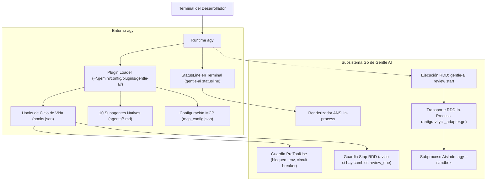

# Propuesta de Integración Upstream: Google Antigravity CLI (`agy`) en Gentle AI

**Estado:** Lista para Revisión y Merge  
**Destino:** `Gentleman-Programming/gentle-ai` (Rama principal upstream)  
**Identificador de Agente:** `model.AgentAntigravityCLI` (`"antigravity-cli"`)  
**Alcance:** Adaptador de agente en Go, pipeline de assets determinista, transporte de revisión RDD in-process, 10 subagentes nativos y hooks de ciclo de vida.  

---

## 1. Resumen Ejecutivo

Esta propuesta formaliza la incorporación de una integración dedicada y de primer nivel para **Google Antigravity CLI (`agy`)** dentro del repositorio oficial de Gentle AI (`Gentleman-Programming/gentle-ai`).

El ecosistema de Google Antigravity engloba tres entornos distintos: **Antigravity IDE** (editor gráfico), **Antigravity App (2.0)** (plataforma dedicada de agentes) y **Antigravity CLI** (`agy`, runtime de terminal). Actualmente, el repositorio upstream cuenta con un adaptador genérico denominado `antigravity` que intentó abarcar los tres entornos con un enfoque plano en `GEMINI.md`.

Esta integración desacopla la experiencia de terminal mediante un adaptador especializado (`model.AgentAntigravityCLI`), ofreciendo:
1. **Empaquetado Nativo de Plugin**: Despliegue completo con `plugin.json`, `rules/`, `agents/`, `skills/`, `mcp_config.json` y `hooks.json`.
2. **10 Subagentes Nativos**: Subagentes en Markdown con herramientas acotadas para el ciclo ODD, Judgment Day y revisión 4R.
3. **Transporte RDD In-Process y Hermético**: Ejecución de revisiones bajo Receipt-Driven Development en subprocesos aislados de `agy` con `--sandbox` e inspección de árboles Git inmutables.
4. **Puente de Hooks y Seguridad**: Intercepción en memoria (`PreToolUse`) para bloquear lectura de secretos (`.env*`, `.ssh`), circuit breaker anti-bucles y recordatorio de cierre (`Stop`).
5. **StatusLine In-Process de Alto Rendimiento**: Barra de estado nativa en Go ejecutada por stdin con latencia menor a 5 ms y auto-silenciado si el plugin está inactivo.
6. **Cero Regresiones**: El código añadido es puramente aditivo o condicional a `AgentAntigravityCLI`, sin romper ningún otro cliente ni la integración preexistente de upstream.
7. **Compatibilidad con el Ecosistema**: Centrada y verificada en `agy`, y potencialmente compatible con el resto del ecosistema `antigravity` (IDE y App (2.0)), aunque no está certificado.

---

## 2. Motivación Técnica: Del Enfoque Genérico a la Especialización de CLI

El adaptador genérico heredado `antigravity` intentó agrupar IDE, App (2.0) y CLI en un único bloque:
- Concatena las directivas en un único archivo de texto plano (`.gemini/GEMINI.md`).
- Deja `SubAgentsDir` vacío (`""`), impidiendo que el usuario de Antigravity disponga de subagentes especializados.
- Carece de transporte RDD (`transport: nil`), dejando a los usuarios de Antigravity fuera del flujo de revisión formal.
- No gestiona hooks ni statuslines de terminal.
- Genera riesgos de colisión de rutas al escribir en `~/.gemini/antigravity-cli/skills` y `GEMINI.md` simultáneamente.

`agy` es un runtime moderno de agentes para terminal, capaz de descubrir plugins modulares, ejecutar herramientas con control de permisos y correr procesos confinados. Intentar conciliar las necesidades de una terminal autónoma con un enfoque pasivo de editor degrada la experiencia del desarrollador en terminal.

La solución arquitectónica correcta es mantener el adaptador genérico para entornos pasivos y proveer el adaptador especializado `antigravity-cli` para el runtime de terminal `agy`.

---

## 3. Arquitectura y Componentes Clave



### A. Adaptador de Agente (`internal/agents/antigravitycli/`)
- Soporta tanto instalación global (`~/.gemini/config/plugins/gentle-ai/`) como en workspace (`<repo>/.agents/plugins/gentle-ai/`).
- En alcance workspace garantiza aislamiento total: cero escrituras en `$HOME` y descubrimiento nativo por parte de `agy`.
- Preserva la higiene de Git gestionando exclusiones en `.git/info/exclude` en lugar de ensuciar el `.gitignore` del usuario.

### B. Transporte de Revisión RDD (`internal/reviewerprovider/antigravitycli_adapter.go`)
- Implementa `reviewerprovider.Adapter` para `agy`.
- Lanza revisores en subprocesos independientes invocando `agy --sandbox` sobre un árbol Git temporal e inmutable.
- Admisión estricta del resultado mediante validación del esquema JSON en Go.
- Admite roles de refutación (`review-refuter`) y validación (`review-validator`) configurables en `review-models.json`.

### C. Pipeline de Assets y Drift Gate (`scripts/transpile-antigravitycli/`)
- Transpilador determinista que convierte los assets canónicos de Gentle Shell al formato esperado por `agy`.
- Gate de verificación `--check` que valida en CI byte a byte contra el commit fijado de Gentle Shell (`PROVENANCE.json`).
- Asegura que el nombre de cada skill coincida con su directorio, cumpliendo la validación estricta oficial.

### D. Hooks de Ciclo de Vida y Seguridad (`internal/cli/antigravity_hook.go`)
- `PreToolUse`: Intercepta llamadas y deniega (`deny`) accesos a archivos sensibles (`.env*`, `.ssh`, tokens, certificados).
- `PreToolUse`: Tokeniza comandos de terminal para evitar elusiones tipo `cat .env`.
- `PreToolUse`: Circuit breaker que corta bucles infinitos tras 3 llamadas consecutivas idénticas.
- `Stop`: Impide el cierre accidental si la sesión deja código de alto riesgo sin revisar (`review_due`).
- Detección multi-root: Rastrea mutaciones en repositorios anidados o submódulos a partir del ledger de la sesión (`b64da1efe`).

### E. StatusLine In-Process (`internal/statusline/`)
- Ejecución in-process de latencia ultra baja (`<5 ms`) alimentada por stdin.
- Indicador estático `✿`, modo/modelo, gauge de contexto, countdown de cuotas, memoria Engram y estado RDD.
- Auto-silenciado transparente cuando el plugin está inactivo (`plugins.gentle-ai.enabled: false`).
- Configuración desatendida mediante la opción `--include-theme` en `install` y `sync`.

---

## 4. Matriz de Pruebas y Evidencia Empírica

La integración cuenta con cobertura de pruebas automatizadas y validación oficial:

| Suite de Pruebas | Archivo de Prueba | Escenarios Verificados | Estado |
|---|---|---|---|
| Adaptador CLI | `internal/agents/antigravitycli/adapter_test.go` | Detección de rutas, despliegue global y workspace, poda de skills obsoletas. | ✅ PASS |
| Hooks de Ciclo de Vida | `internal/cli/antigravity_hook_test.go` | Bloqueo de `.env`, tokenización de comandos, circuit breaker, multi-root git. | ✅ PASS |
| Transporte RDD | `internal/reviewerprovider/antigravitycli_adapter_test.go` | Invocación de subproceso, bandera `--sandbox`, esquemas JSON inmutables. | ✅ PASS |
| Routing de Modelos | `internal/reviewerprovider/antigravitycli_routing_test.go` | Mapeo de roles 4R, refuter y validator; resolución de modelos y esfuerzo. | ✅ PASS |
| Statusline | `internal/cli/statusline_test.go` | Inyección de tema, auto-silenciado, countdown de cuotas y parsing ANSI. | ✅ PASS |
| Drift Gate de Assets | `scripts/transpile-antigravitycli/main_test.go` | Transpilación determinista y verificación byte a byte contra Gentle Shell. | ✅ PASS |

### Validación Estricta con la Herramienta Oficial de Google
```bash
agy plugin validate --strict ~/.gemini/config/plugins/gentle-ai
```
- **Resultado:** Código de salida `0`, `0` advertencias y `0` errores.

---

## 5. Garantías de No-Regresión para Upstream

1. **Aislamiento en Código Compartido:**
   Las modificaciones en archivos centrales (`internal/cli/run.go`, `internal/cli/sync.go`, `internal/catalog/agents.go`, `internal/components/permissions/inject.go`) son estrictamente aditivas o condicionadas a `model.AgentAntigravityCLI`. Ningún otro cliente se ve afectado.
2. **Exclusión de Archivos Propios del Fork:**
   Siguiendo la política de [`FORK.md`](../../FORK.md), los workflows privados de CI (`.github/workflows/fork-ci.yml`), scripts de preflight de release y firmas de release quedan totalmente excluidos del Pull Request a upstream.
3. **Compatibilidad con la Integración IDE:**
   El adaptador `antigravity` existente permanece intacto. Los usuarios del IDE continúan usando `GEMINI.md` sin interferencias.

---

## 6. Plan de Merge Sugerido

1. **Paso 1:** Incorporación del modelo de agente y catálogo (`model.AgentAntigravityCLI`).
2. **Paso 2:** Incorporación del paquete `internal/agents/antigravitycli/` y assets generados.
3. **Paso 3:** Incorporación del transpilador y gate `--check` en `scripts/transpile-antigravitycli/`.
4. **Paso 4:** Incorporación de hooks (`internal/cli/antigravity_hook.go`) y statusline (`internal/statusline/`).
5. **Paso 5:** Incorporación del adaptador RDD (`internal/reviewerprovider/antigravitycli_adapter.go`).
6. **Paso 6:** Documentación en `docs/agents.md`, `README.md` y `docs/antigravity-cli/`.
