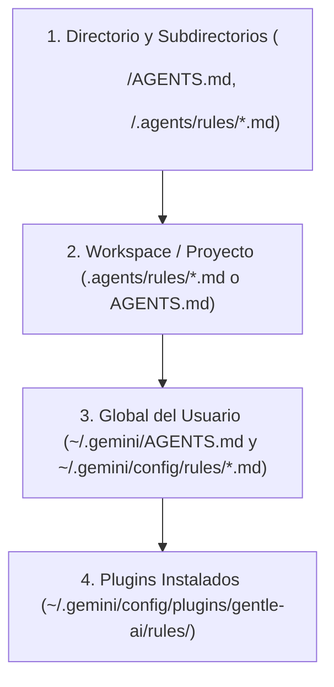
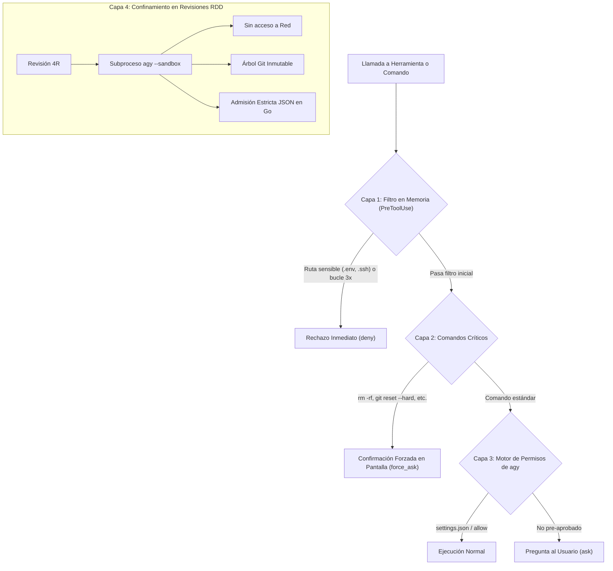

# Seguridad, Jerarquías y Políticas de Sandbox en Antigravity CLI

La integración de Antigravity CLI (`agy`) en Gentle AI implementa un modelo de defensa en profundidad diseñado para proteger tus credenciales, prevenir la ejecución accidental de comandos destructivos y mantener la higiene total de tu repositorio.

---

## 1. Jerarquía de Reglas y Configuración en Antigravity

Antigravity CLI utiliza un sistema acumulativo de directivas donde conviven reglas en distintos niveles del sistema. Para evitar comportamientos inesperados, es fundamental comprender cómo se ordenan y qué precedencia tienen:

### Precedencia de Reglas (De mayor a menor especificidad)
1. **Directorio y subdirectorios locales**: Archivos `AGENTS.md` o reglas en `.agents/rules/*.md` dentro de la carpeta actual. Tienen la máxima prioridad.
2. **Workspace (Proyecto)**: Reglas en la raíz del repositorio. Tienen prioridad sobre cualquier configuración global.
3. **Global de la máquina**: Reglas generales del usuario en `~/.gemini/AGENTS.md` o en `~/.gemini/config/rules/*.md`.
4. **Plugins instalados**: Reglas provistas por plugins como Gentle AI en `~/.gemini/config/plugins/gentle-ai/rules/` (o `<repo>/.agents/plugins/gentle-ai/rules/` si se instaló en modo workspace).

### Modos de Activación de Reglas (`trigger`)
Cada archivo modular en `rules/*.md` define en su encabezado YAML cómo y cuándo se inyecta en el contexto del modelo:
- **`always_on`**: Se carga en el prompt de sistema en cada turno. Gentle AI lo utiliza para sus reglas principales de orquestación.
- **`model_decision`**: Se inyecta únicamente el índice con la descripción (`description`); el modelo decide leer el archivo completo solo si la tarea lo requiere.
- **`glob`**: Se activa automáticamente únicamente cuando el modelo interactúa con archivos que coinciden con patrones específicos.
- **`manual`**: Se carga únicamente cuando el usuario lo menciona explícitamente con `@` en la conversación.

### Presupuesto y Límites de Contexto
Para evitar que las reglas desborden la ventana de contexto del LLM:
- **Límite individual:** Ningún archivo de regla puede superar los **24 KB (24.000 bytes)**; de lo contrario, `agy` lo trunca.
- **Presupuesto compartido:** Todas las reglas `always_on` comparten un presupuesto total de **20.000 tokens**. Si se supera, `agy` degrada automáticamente las reglas más pesadas a punteros livianos basados en su `description`.

---

## 2. Jerarquía de Permisos y Embudo de Seguridad (4 Capas)

Cuando el agente intenta ejecutar una acción (leer un archivo, modificar código o tirar un comando de terminal), la solicitud atraviesa un embudo de 4 capas de control antes de llegar al sistema operativo:

### Capa 1: Filtro Preventivo en Memoria (`PreToolUse`)
El hook de Gentle AI se ejecuta en Go antes de que la herramienta toque el disco:
- **Bloqueo incondicional de secretos (`deny`)**: Si la herramienta (`read_file`, `grep_search`, `write_file`) referencia rutas como `.env*` a cualquier profundidad, `.ssh/`, `.credentials`, tokens en `hosts.yml`, certificados `.pem`, claves `.key` o carpetas `secrets/`, la llamada se aborta de inmediato con `deny`.
- **Análisis semántico de terminal**: Si se invoca `run_command`, la línea se tokeniza para detectar y bloquear intentos de lectura evasivos (ej. `cat .env`, `grep SECRET .env` o `source .env`).
- **Circuit Breaker anti-bucles**: Si el modelo se traba e invoca consecutivamente 3 veces la misma herramienta con los mismos argumentos, el hook devuelve `deny` para cortar el consumo innecesario de tokens.

### Capa 2: Detección de Comandos Destructivos (`force_ask`)
Si un comando de terminal contiene operaciones peligrosas como:
- `rm -rf`, `sudo rm -rf`
- `git reset --hard`, `git clean -fd`, `git push --force`
- `chmod -R 777`, `chown -R`

El hook responde con **`force_ask`**. Esto obliga a Antigravity CLI a solicitar una confirmación explícita e interactiva en la pantalla del usuario, **ignorando cualquier caché previa o regla permisiva en `settings.json`**.

### Capa 3: Motor Nativo de Permisos de Antigravity CLI (`ask` / `allow`)
Para comandos normales y herramientas dentro del workspace:
- Si el comando ya fue autorizado por el usuario en `~/.gemini/antigravity-cli/settings.json` (`permissions.allow`), se ejecuta con normalidad (`allow`).
- Si es la primera vez que se ejecuta, `agy` delega en el usuario mediante una consulta interactiva en terminal (`ask`).

### Capa 4: Confinamiento del Sandbox en Revisiones RDD (`--sandbox`)
Durante el ciclo de revisión formal de código (Receipt-Driven Development):
- Cada revisor corre en un subproceso independiente de `agy` invocado con el flag **`--sandbox`**.
- **Sin acceso a internet:** Se bloquea todo tráfico de red saliente.
- **Árbol Git inmutable:** El revisor inspecciona un snapshot temporal congelado, impidiendo que modifique el código en vivo o altere el estado del repositorio.
- **Admisión estricta en Go:** La salida devuelta por el revisor se valida contra esquemas JSON estrictos en Go; cualquier dato malformado o anómalo es descartado.

---

## 3. Higiene del Repositorio y Entornos Complejos

### Cero Ensuciado de `.gitignore` (`.git/info/exclude`)
Gentle AI genera archivos temporales de sincronización (como metadatos `.atl` y ledgers de mutaciones efímeros). En lugar de modificar tu archivo `.gitignore` y ensuciar tus commits o Pull Requests:
- Las reglas de exclusión se escriben en el archivo local de exclusiones de Git: **`.git/info/exclude`**.
- Tu historial de Git, tus diffs y tus Pull Requests permanecen 100% limpios sin rastros de archivos del agente.

### Detección Multi-Root en Monorepos y Submódulos
Si trabajás en un repositorio que contiene submódulos o múltiples raíces Git:
- El hook de cierre (`Stop`) analiza las rutas reales modificadas en el ledger de la sesión (`b64da1efe`).
- Identifica automáticamente cada raíz de Git afectada y comprueba que ningún subproyecto con cambios de alto riesgo quede sin revisar.
